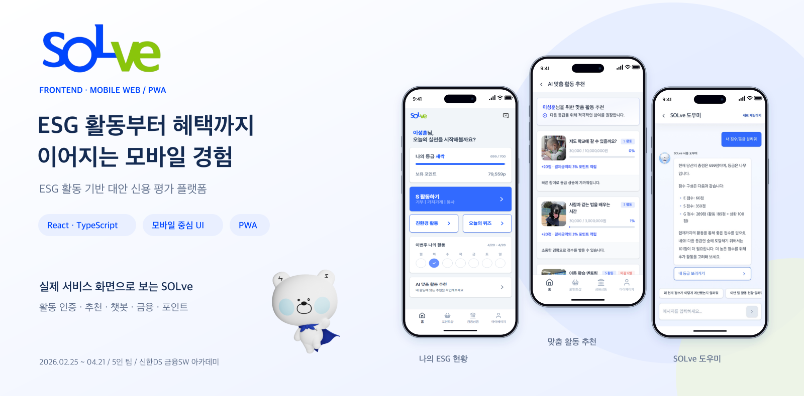
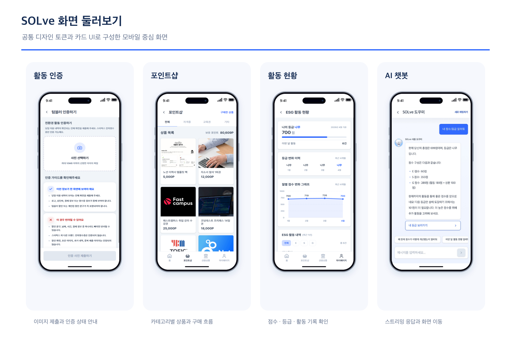
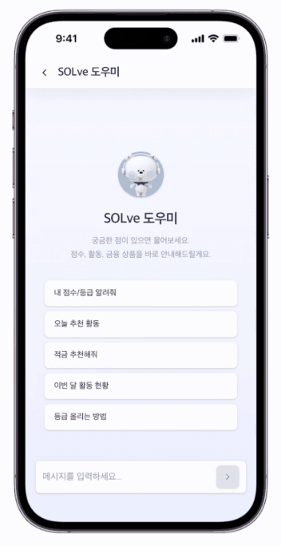

# SOLve Frontend

**일상 속 ESG 활동을 인증하고 점수화해, 금융 혜택과 성장 기회로 연결하는 플랫폼입니다.**

React·TypeScript 기반의 모바일 중심 PWA로, ESG 활동 인증과 맞춤 추천, AI 챗봇, 금융상품·포인트샵, 활동 인증서 화면을 제공합니다.


**[프로젝트 전체 소개](https://github.com/SH6-SanaiClub/SOLve-be/blob/develop/README.md)** · [Backend 저장소](https://github.com/SH6-SanaiClub/SOLve-be) · [팀원·역할·기여](#team) · [Frontend 실행하기](#getting-started)

주요 기능, 서비스 아키텍처, API 명세, 팀 구성과 트러블슈팅은 백엔드 저장소의 대표 README에서 확인할 수 있습니다. 현재 서비스 배포는 종료되었으며, 아래 화면과 시연 GIF로 결과물을 확인할 수 있습니다.

## 📱 화면 둘러보기



<details>
<summary>AI 챗봇 시연 보기</summary>

사용자 점수·등급에 근거한 답변과 관련 화면 이동을 제공합니다. 아래 GIF는 제출 시연 영상에서 발췌한 2배속 장면입니다.

<p align="center">
  
</p>

</details>

<a id="team"></a>

## 👥 팀원 소개 및 역할·기여

팀원별 주요 역할과 구현 기여입니다.

| 팀원 | 역할 | 주요 기여 |
| --- | --- | --- |
| [이성훈](https://github.com/shoon0123)<br>`shoon0123` | Frontend · Backend | 프로젝트 일정·설계, ERD, ESG 점수·포인트 정책과 정산, 금융상품·대출 심사, 자동 상환·납입 시뮬레이션 |
| [김수빈](https://github.com/Kimsubinnn)<br>`Kimsubinnn` | Frontend · Backend · AI | 회원가입·로그인·본인인증, AI 금융 퀴즈 생성, 사용자 이력 기반 맞춤 출제·채점 |
| [김연아](https://github.com/KimYeonAh)<br>`KimYeonAh` | Design · Frontend · Backend | Figma 화면 설계, 기부·가치가게 결제, 봉사 신청·QR·GPS 출석과 상태 전환, 관련 이용 내역 |
| [김영빈](https://github.com/sttarrynight)<br>`sttarrynight` | Frontend · Backend · AI | 성향 설문, ESG 활동·적금 추천 엔진, AI 챗봇, 관리자 기능, 초기 개발 환경·PR 빌드 확인·배포 설정 |
| [이은희](https://github.com/qscv06532)<br>`qscv06532` | Frontend · Backend · AI | AI·OCR 기반 E 활동 인증, 메인 대시보드, 포인트샵, 마이페이지·PDF 인증서, 가상 CB 기반 대출 컷오프 |

<a id="getting-started"></a>

## 🚀 시작하기

### 실행 환경

- Node.js **22 LTS 최신 패치**, npm **10 이상**
- 실행 중인 Backend: 기본 주소 `http://localhost:8080`
- [Backend 실행 및 초기 데이터 안내](https://github.com/SH6-SanaiClub/SOLve-be/blob/develop/README.md#getting-started)

### 설치

```bash
git clone --branch develop https://github.com/SH6-SanaiClub/SOLve-fe.git
cd SOLve-fe

# nvm을 사용하는 경우
nvm use

npm ci
```

### 환경 변수

프로젝트 루트에 `.env`를 작성합니다. API 설정은 생략하면 아래 기본값을 사용합니다. PortOne 값은 본인인증·결제 이용 시 자신의 연동 설정으로 교체합니다.

```dotenv
VITE_API_BASE_URL=/api
VITE_API_TIMEOUT_MS=30000

# PortOne 본인인증·결제 이용 시 설정
VITE_PORTONE_IMP_CODE=your-portone-imp-code
VITE_PORTONE_CHANNEL_KEY=your-portone-channel-key
```

환경 변수는 [config.ts](./src/constants/config.ts)에서 관리합니다. Vite의 개발 서버는 `/api` 요청을 `http://localhost:8080`으로 프록시합니다. 연결 대상은 [vite.config.ts](./vite.config.ts)에서 확인할 수 있습니다.

### 실행

```bash
npm run dev
```

브라우저에서 [http://localhost:5173](http://localhost:5173)으로 접속합니다.

| 명령어 | 설명 |
| --- | --- |
| `npm run dev` | 개발 서버 실행 |
| `npm run build` | TypeScript 검사 및 배포 빌드 |
| `npm run preview` | 빌드 결과 로컬 확인 |
| `npm run lint` | ESLint 검사 |
| `npm run test` | Vitest 실행 |

## 🗂 개발 문서

| 문서 | 내용 |
| --- | --- |
| [프로젝트 대표 README](https://github.com/SH6-SanaiClub/SOLve-be/blob/develop/README.md) | 서비스 소개·아키텍처·API·팀원·트러블슈팅 |
| [공통 컴포넌트 규칙](./docs/common-component-rules.md) | 공통 UI 컴포넌트 사용 기준 |
| [라우팅](./src/routes/Router.tsx) | 페이지 구성과 접근 제어 |
| [디자인 토큰](./src/index.css) | 브랜드 컬러·간격·곡률·타이포그래피 |
